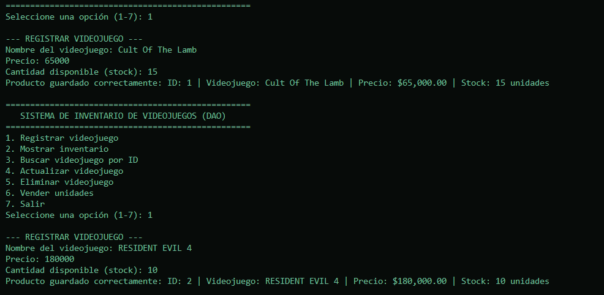
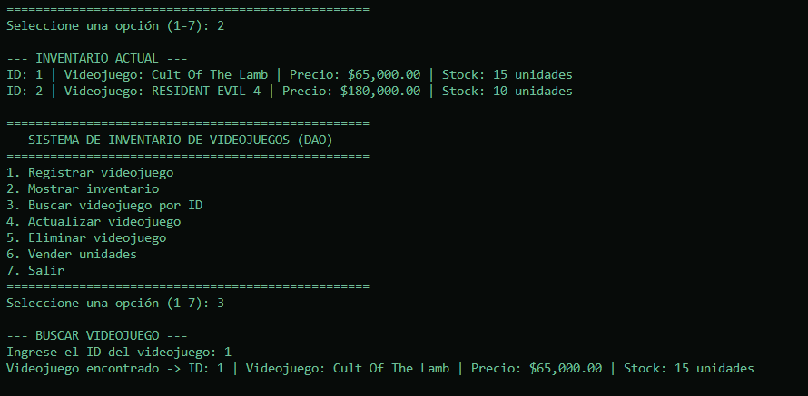
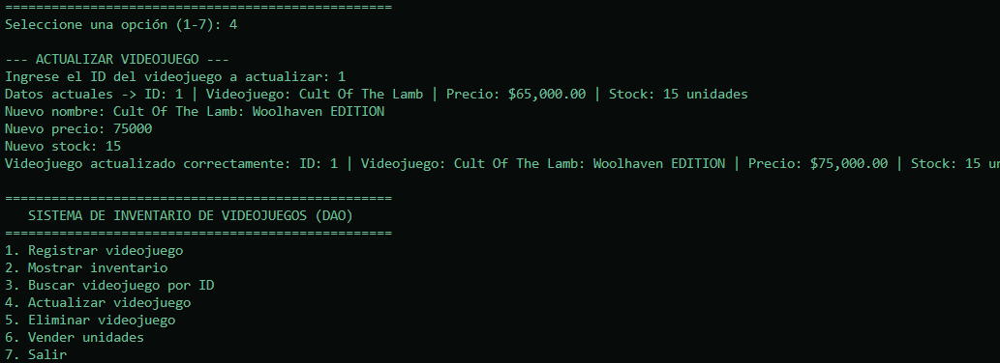
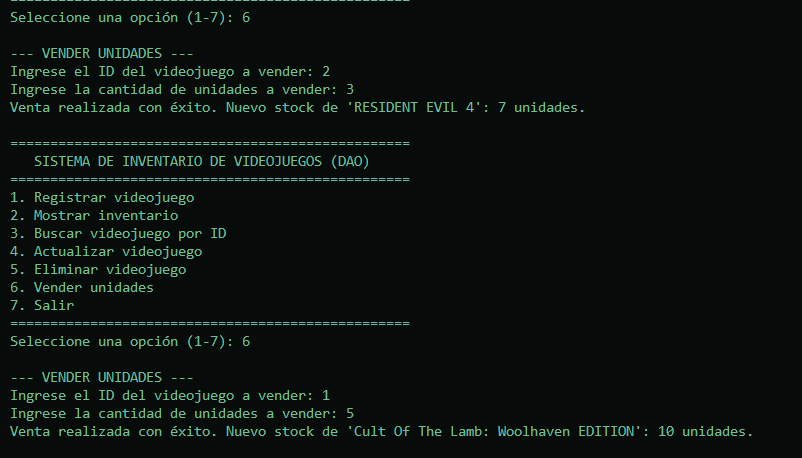
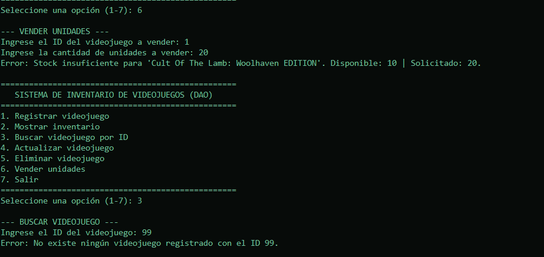
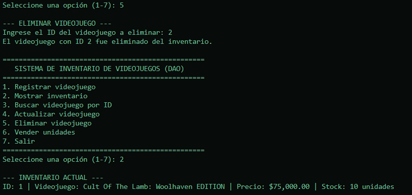

# Sistema de Inventario de Videojuegos - Patrón DAO y SQLite

Aplicación de consola desarrollada en Python para la administración integral de un inventario de videojuegos. El proyecto implementa persistencia de datos mediante **SQLite** y está construido bajo una arquitectura por capas que aplica el patrón de diseño **DAO (Data Access Object)** junto con una capa de **Servicios** encargada de las reglas de negocio.

---

## 1. Propósito del Sistema

El objetivo de esta aplicación es gestionar el catálogo y las existencias de una tienda de videojuegos mediante un menú interactivo de consola. Permite ejecutar todas las operaciones **CRUD** (Crear, Leer, Actualizar y Eliminar) y procesar ventas descontando unidades del inventario en tiempo real.

Para garantizar la calidad e integridad de los datos, el sistema:
- Conserva toda la información en una base de datos local (`inventario.db`) entre distintas ejecuciones.
- Elimina el registro automático del videojuego de ejemplo del programa principal para evitar duplicados cada vez que se ejecuta.
- Controla y valida todas las entradas del usuario antes de realizar cambios en la base de datos.

---

## 2. Estructura del Proyecto y Separación de Responsabilidades

El sistema está dividido en cinco módulos independientes dentro del repositorio, cumpliendo el requisito técnico de separar la interfaz de consola, las reglas de negocio y el acceso a los datos:

```text
app_DAO/
├── modelo.py             # Contiene la clase Producto (entidad principal del dominio)
├── base_datos.py         # Administra la conexión y creación de la base de datos SQLite
├── producto_dao.py       # Contiene las operaciones SQL necesarias para el CRUD
├── producto_servicio.py  # Implementa las validaciones y reglas del negocio
├── main.py               # Contiene el menú interactivo y utiliza los métodos del servicio
├── inventario.db         # Base de datos SQLite donde se persiste la información
├── capturas/             # Evidencias gráficas de las pruebas de funcionamiento
│   ├── 01_registro.png
│   ├── 02_mostrar_y_buscar.png
│   ├── 03_actualizar.png
│   ├── 04_venta_exitosa.png
│   ├── 05_operaciones_rechazadas.png
│   └── 06_eliminar.png
└── README.md             # Documentación técnica
```

### Comunicación Modular (`from ... import ...`)

Para cumplir la regla técnica de **no escribir consultas SQL directamente en `main.py`**, cada módulo utiliza la instrucción `from <archivo> import <Clase>` al inicio del archivo para comunicarse únicamente con la capa que le corresponde:

1. **`modelo.py` y `base_datos.py` (Capas Base):**
   - `modelo.py` define la estructura del objeto `Producto` (`id`, `nombre`, `precio`, `stock`).
   - `base_datos.py` importa `sqlite3` para conectar con `inventario.db` y garantizar la creación de la tabla `productos`.
2. **`producto_dao.py` (Capa de Acceso a Datos - DAO):**
   - Usa `from base_datos import BaseDatos` y `from modelo import Producto`.
   - Ejecuta exclusivamente las consultas SQL parametrizadas (`INSERT`, `SELECT`, `UPDATE`, `DELETE`) sobre SQLite.
3. **`producto_servicio.py` (Capa de Negocio):**
   - Usa `from modelo import Producto` y `from producto_dao import ProductoDAO`.
   - Valida nombres, precios, stock y existencia de IDs antes de llamar a los métodos del DAO.
4. **`main.py` (Capa de Presentación):**
   - Usa únicamente `from producto_servicio import ProductoServicio`.
   - Muestra el menú interactivo y gestiona la lectura de datos por consola sin tocar SQLite directamente.

---

## 3. Funcionalidades y Validaciones Implementadas

### Operaciones del Menú
1. **Registrar videojuego:** Solicita nombre, precio y cantidad disponible (`stock`).
2. **Mostrar inventario:** Lista todos los videojuegos registrados con su `ID`, `Nombre`, `Precio` y `Stock`.
3. **Buscar videojuego por ID:** Consulta un producto mediante su `ID` e informa si no existe.
4. **Actualizar videojuego:** Modifica nombre, precio y stock de un producto existente.
5. **Eliminar videojuego:** Elimina un producto utilizando su `ID`.
6. **Vender unidades:** Solicita el `ID` del videojuego y la cantidad que se desea vender, descontándola del inventario.
7. **Salir:** Finaliza correctamente la aplicación.

### Validaciones Obligatorias Controladas
- No permite nombres vacíos.
- No acepta precios menores o iguales a cero.
- No permite cantidades de inventario negativas.
- No permite ventas con cantidades menores o iguales a cero.
- No permite vender más unidades de las disponibles en inventario.
- Informa cuando el `ID` solicitado no existe.
- Evita que una entrada incorrecta cierre inesperadamente el programa.

---

## 4. Instrucciones para Ejecutar el Programa

1. Clonar el repositorio público en la máquina local:
   ```bash
   git clone [https://github.com/TU_USUARIO/app_DAO.git](https://github.com/TU_USUARIO/app_DAO.git)
   cd app_DAO
   ```
2. Ejecutar el programa principal con Python:
   ```bash
   python main.py
   ```

---

## 5. Evidencias de las Pruebas Realizadas

### Resumen de Casos Comprobados

| Prueba | Datos Utilizados | Resultado Obtenido | Estado |
| :--- | :--- | :--- | :--- |
| **Registrar Cult Of The Lamb** | Precio: `65000`, Stock: `15` | Producto guardado correctamente (`ID: 1`) | Exitosa |
| **Registrar RESIDENT EVIL 4** | Precio: `180000`, Stock: `10` | Producto guardado correctamente (`ID: 2`) | Exitosa |
| **Mostrar inventario** | Opción `2` | Aparecen ambos productos registrados | Exitosa |
| **Buscar un ID existente** | Opción `3` -> `ID: 1` | Se muestran los datos de `Cult Of The Lamb` | Exitosa |
| **Actualizar un producto** | `ID: 1` -> `Cult Of The Lamb: Woolhaven EDITION`, Precio: `75000`, Stock: `15` | Los cambios quedan guardados en SQLite | Exitosa |
| **Vender 3 unidades de RESIDENT EVIL 4** | Opción `6` -> `ID: 2`, Cantidad: `3` | El stock pasa de `10` a `7` unidades | Exitosa |
| **Vender 5 unidades de Cult Of The Lamb** | Opción `6` -> `ID: 1`, Cantidad: `5` | El stock pasa de `15` a `10` unidades | Exitosa |
| **Intentar vender 20 unidades** | Opción `6` -> `ID: 1`, Cantidad: `20` | Se rechaza la operación y se conserva el stock en `10` | Rechazada |
| **Buscar un ID inexistente** | Opción `3` -> `ID: 99` | Se informa que no existe ningún videojuego con el ID `99` | Rechazada |
| **Eliminar un producto** | Opción `5` -> `ID: 2` | El producto deja de aparecer en el inventario | Exitosa |

---

### 5.1. Registrar Videojuegos (*Cult Of The Lamb* y *RESIDENT EVIL 4*)
Se registran **Cult Of The Lamb** (Precio: `$65,000.00`, Stock: `15 unidades`) y **RESIDENT EVIL 4** (Precio: `$180,000.00`, Stock: `10 unidades`).

```text
--- REGISTRAR VIDEOJUEGO ---
Nombre del videojuego: Cult Of The Lamb
Precio: 65000
Cantidad disponible (stock): 15
Producto guardado correctamente: ID: 1 | Videojuego: Cult Of The Lamb | Precio: $65,000.00 | Stock: 15 unidades

--- REGISTRAR VIDEOJUEGO ---
Nombre del videojuego: RESIDENT EVIL 4
Precio: 180000
Cantidad disponible (stock): 10
Producto guardado correctamente: ID: 2 | Videojuego: RESIDENT EVIL 4 | Precio: $180,000.00 | Stock: 10 unidades
```



---

### 5.2. Mostrar Inventario y Buscar un ID Existente
Se listan todos los videojuegos registrados en el inventario actual (Opción 2) y posteriormente se busca el producto con `ID: 1` (Opción 3).

```text
--- INVENTARIO ACTUAL ---
ID: 1 | Videojuego: Cult Of The Lamb | Precio: $65,000.00 | Stock: 15 unidades
ID: 2 | Videojuego: RESIDENT EVIL 4 | Precio: $180,000.00 | Stock: 10 unidades

--- BUSCAR VIDEOJUEGO ---
Ingrese el ID del videojuego: 1
Videojuego encontrado -> ID: 1 | Videojuego: Cult Of The Lamb | Precio: $65,000.00 | Stock: 15 unidades
```



---

### 5.3. Actualizar un Producto
Se actualiza el videojuego con `ID: 1` modificando su nombre a **Cult Of The Lamb: Woolhaven EDITION**, su precio a `$75,000.00` y su stock a `15` unidades.

```text
--- ACTUALIZAR VIDEOJUEGO ---
Ingrese el ID del videojuego a actualizar: 1
Datos actuales -> ID: 1 | Videojuego: Cult Of The Lamb | Precio: $65,000.00 | Stock: 15 unidades
Nuevo nombre: Cult Of The Lamb: Woolhaven EDITION
Nuevo precio: 75000
Nuevo stock: 15
Videojuego actualizado correctamente: ID: 1 | Videojuego: Cult Of The Lamb: Woolhaven EDITION | Precio: $75,000.00 | Stock: 15 unidades
```



---

### 5.4. Venta Exitosa de Unidades (Operación Exitosa)
Se venden `3` unidades de **RESIDENT EVIL 4** (`ID: 2`), pasando su stock de `10` a `7` unidades, y `5` unidades de **Cult Of The Lamb: Woolhaven EDITION** (`ID: 1`), pasando su stock de `15` a `10` unidades.

```text
--- VENDER UNIDADES ---
Ingrese el ID del videojuego a vender: 2
Ingrese la cantidad de unidades a vender: 3
Venta realizada con éxito. Nuevo stock de 'RESIDENT EVIL 4': 7 unidades.

--- VENDER UNIDADES ---
Ingrese el ID del videojuego a vender: 1
Ingrese la cantidad de unidades a vender: 5
Venta realizada con éxito. Nuevo stock de 'Cult Of The Lamb: Woolhaven EDITION': 10 unidades.
```



---

### 5.5. Intentar Vender 20 Unidades y Buscar ID Inexistente (Operaciones Rechazadas)
Se comprueba que al intentar vender `20` unidades de **Cult Of The Lamb: Woolhaven EDITION** (`ID: 1`) teniendo solo `10` disponibles, el sistema rechaza la operación y conserva el stock intacto. Asimismo, al buscar el `ID: 99`, informa que no existe.

```text
--- VENDER UNIDADES ---
Ingrese el ID del videojuego a vender: 1
Ingrese la cantidad de unidades a vender: 20
Error: Stock insuficiente para 'Cult Of The Lamb: Woolhaven EDITION'. Disponible: 10 | Solicitado: 20.

--- BUSCAR VIDEOJUEGO ---
Ingrese el ID del videojuego: 99
Error: No existe ningún videojuego registrado con el ID 99.
```



---

### 5.6. Eliminar un Producto
Se elimina el videojuego con `ID: 2` (**RESIDENT EVIL 4**) y se vuelve a mostrar el inventario (Opción 2), comprobando que el producto eliminado ya no aparece y que **Cult Of The Lamb: Woolhaven EDITION** conserva sus `10` unidades en SQLite.

```text
--- ELIMINAR VIDEOJUEGO ---
Ingrese el ID del videojuego a eliminar: 2
El videojuego con ID 2 fue eliminado del inventario.

--- INVENTARIO ACTUAL ---
ID: 1 | Videojuego: Cult Of The Lamb: Woolhaven EDITION | Precio: $75,000.00 | Stock: 10 unidades
```


